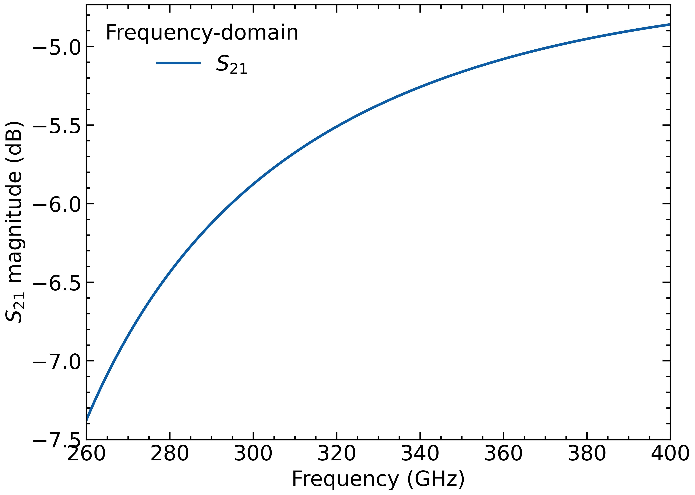
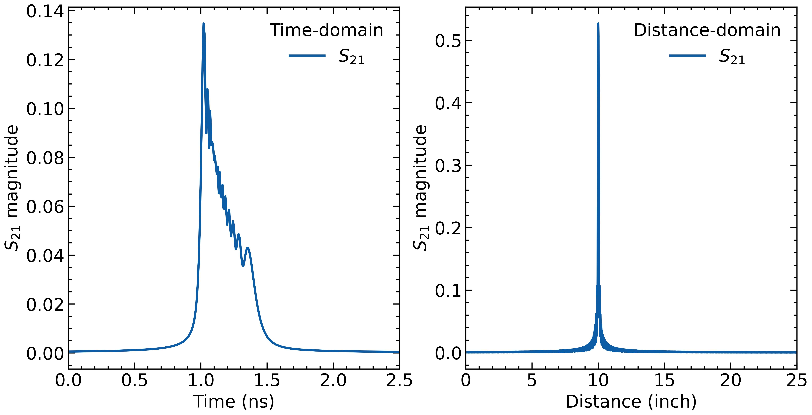
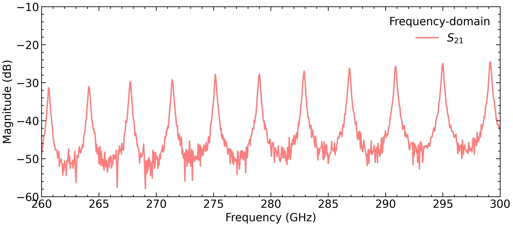
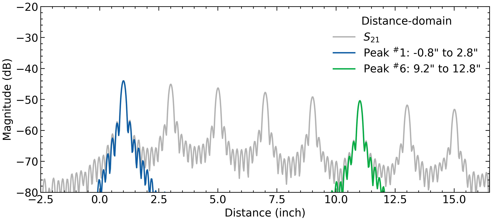
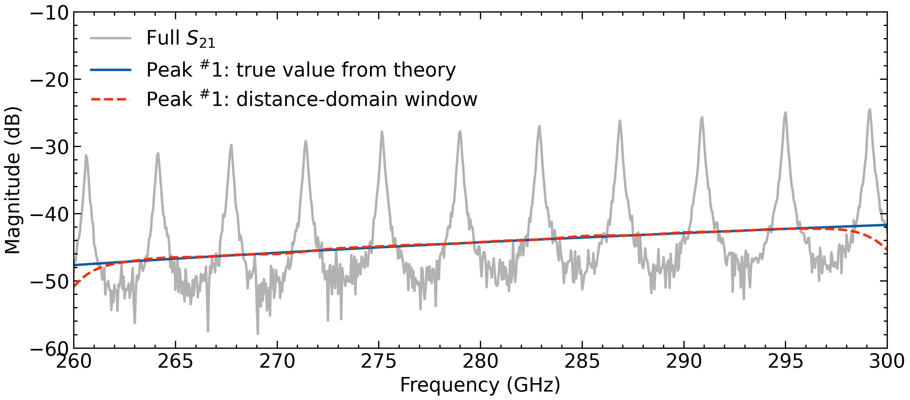
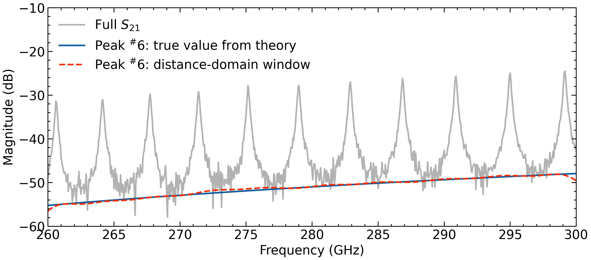

Dispersion-Compensated Algorithm
================================

[](https://badge.fury.io/py/disptrans)
[](https://github.com/garrettj403/DispersionTransform/actions/workflows/ci.yml)
[](https://github.com/garrettj403/DispersionTransform/actions/workflows/linter.yml)
[](https://github.com/garrettj403/DispersionTransform/blob/main/LICENSE.md)

*Dispersion-Compensated Algorithm for the Analysis of Electromagnetic Waveguides*

This package allows you to map dispersive waveguide data from the frequency-domain to distance-domain, and vice versa. The benefit of this approach, compared to a standard Fourier transform, is that this algorithm compensates for dispersion. Normally, dispersion causes signals in the time-domain to broaden as they propagate, making it difficult to isolate or suppress adjacent signals. In the distance-domain, the signals remain sharp, even over long distances, allowing you to easily identify, isolate or suppress specific signals.

For more information, see: 

   - J. D. Garrett and C. E. Tong, ["A Dispersion-Compensated Algorithm for the Analysis of Electromagnetic Waveguides",](https://ieeexplore.ieee.org/document/9447194) *IEEE Signal Processing Letters*, vol. 28, pp. 1175-1179, Jun. 2021, doi: [10.1109/LSP.2021.3086695](https://doi.org/10.1109/LSP.2021.3086695).

Getting Started
---------------

You can install the DispersionTransform package using ``pip``:

   ```bash
   # to install the latest release (from PyPI)
   pip install disptrans

   # to install the latest commit (from GitHub)
   git clone https://github.com/garrettj403/DispersionTransform.git
   cd DispersionTransform
   pip install -e .

   # to install dependencies for examples
   pip install -e ".[examples]"

   # to install dependencies for testing
   pip install -e ".[testing]"
   ```

The package requires Python 3.10 or newer.

Usage
-----

   ```python
   import disptrans

   # f: frequency [Hz], s21f: frequency-domain response, beta: phase constant [rad/m]
   # (beta must be real and strictly monotonic, i.e., all frequencies above cutoff)

   # Frequency-domain -> distance-domain
   # (x [m] is optional; by default, it covers one unambiguous range starting at 0)
   x = disptrans.default_distance(beta)
   s21x = disptrans.freq2distance(f, s21f, beta, x)

   # Isolate a single reflection centered at 1 m (+/- 0.05 m)
   s21x_gated = disptrans.gate(x, s21x, center=1.0, half_width=0.05, window="hamming")

   # Distance-domain -> frequency-domain (x must be uniformly spaced)
   s21f_gated = disptrans.distance2freq(x, s21x_gated, beta, f)
   ```

The phase constant can be calculated using, e.g., [scikit-rf](https://scikit-rf.readthedocs.io/) (``RectangularWaveguide(...).beta``). See the [examples](https://github.com/garrettj403/DispersionTransform/tree/main/examples) for complete scripts.

Example: Simple Waveguide Section
---------------------------------

Transmission through a 10" long gold-plated WR-2.8 waveguide:

<p align="center">

</p>

Below, the time-domain response (calculated by an IFFT) is compared to the distance-domain response. Notice how much sharper the distance-domain response is.

<p align="center">

</p>

Example: Waveguide Cavity Resonator
-----------------------------------

This is a quick example showing the power of the dispersion-compensated algorithm. See [the included notebook](https://github.com/garrettj403/DispersionTransform/blob/main/examples/waveguide-cavity.ipynb) for more information.

For this example, we will start with the frequency-domain response of a simple waveguide cavity resonator, as shown below. This is a 1 inch long WR-2.8 cavity. Whenever the length of the cavity is an integer number of the guided wavelength divided by two, there is a peak in transmission.

<p align="center">

</p>

In the distance-domain, we can see a series of reflections corresponding to different signal paths within the resonator. The first peak is the signal passing straight through the resonator (distance = 1 inch), the second peak is the signal that undergoes one internal back-and-forth reflection (distance = 3 inch), etc.

<p align="center">

</p>

In the distance-domain, we can easily isolate the first peak and then return to the frequency-domain. The isolated reflection provides a very close match to theory.

<p align="center">

</p>

Likewise, we can easily isolate the 6th peak and return to the frequency-domain. This is impossible in the time-domain because there is too much broadening and overlap between adjacent reflections.

<p align="center">

</p>

Note: This example is similar to the example presented by [Garrett & Tong 2021](https://ieeexplore.ieee.org/document/9447194), but it is slightly different (e.g., different dimensions, different iris parameters, etc.). Please see this paper for more information.

Citing This Repo
----------------

If you use this code, please cite the following paper:

    @article{Garrett2021,
      author       = {John D. Garrett and
                      Cheuk-yu Edward Tong},
      title        = {{A Dispersion-Compensated Algorithm for the Analysis of Electromagnetic Waveguides}},
      volume       = {28},
      pages        = {1175--1179},
      month        = jun,
      year         = {2021},
      journal      = {IEEE Signal Processing Letters},
      doi          = {10.1109/LSP.2021.3086695},
      url          = {https://ieeexplore.ieee.org/document/9447194}
    }
